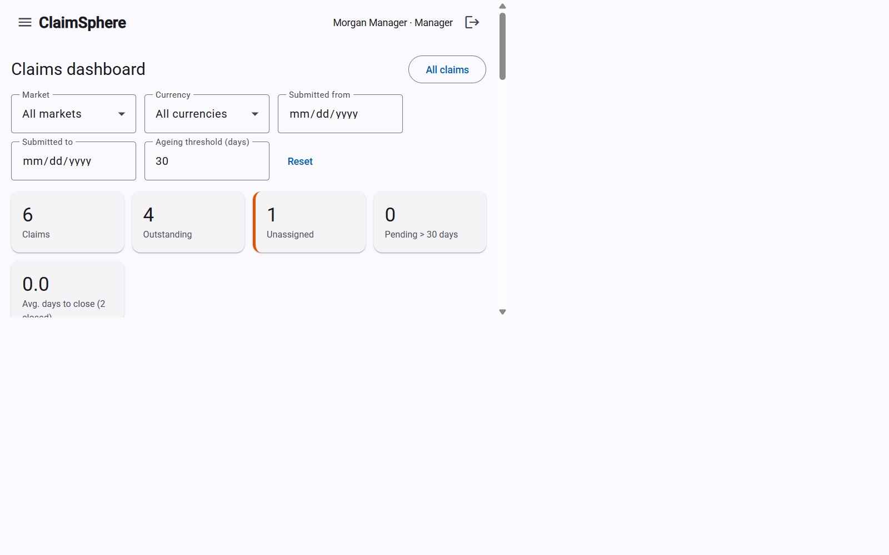
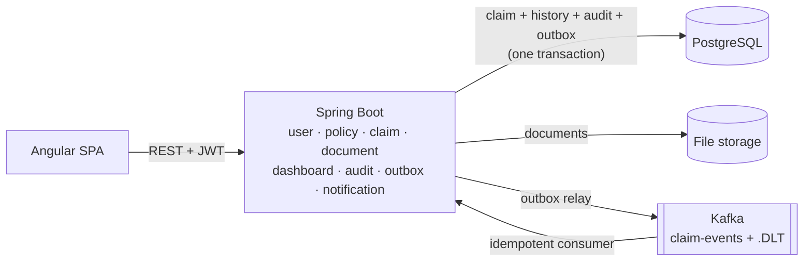
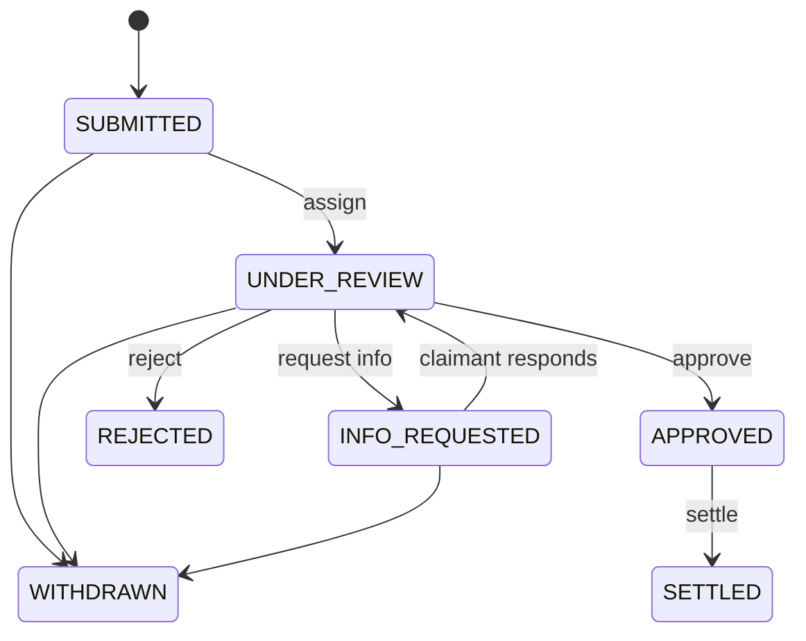

# ClaimSphere: Insurance Claims Management Platform

ClaimSphere is a full-stack claims platform inspired by the Chubb APAC assessment. Claimants report incidents, upload documents and track decisions. Claims officers work a queue, assess, request information, approve or reject, and settle. Managers see workload, ageing and liability across six APAC markets.



## Contents

1. [Business problem](#1-business-problem)
2. [Features](#2-features)
3. [User roles](#3-user-roles)
4. [Technology stack](#4-technology-stack)
5. [Architecture](#5-architecture)
6. [Database design](#6-database-design)
7. [REST API overview](#7-rest-api-overview)
8. [Kafka event architecture](#8-kafka-event-architecture)
9. [Local prerequisites](#9-local-prerequisites)
10. [Backend startup](#10-backend-startup)
11. [Frontend startup](#11-frontend-startup)
12. [Docker Compose](#12-docker-compose)
13. [Kubernetes (Minikube)](#13-kubernetes-minikube)
14. [Testing](#14-testing)
15. [Sample accounts](#15-sample-accounts)
16. [Verification status](#16-verification-status)
17. [Known limitations](#17-known-limitations)
18. [Future enhancements](#18-future-enhancements)

More documentation:
- [Architecture](docs/architecture.md)
- [API](docs/api-documentation.md)
- [Database design](docs/database-design.md)
- [Demo walkthrough](docs/walkthrough.md)
- [Architecture decision records](docs/adr)
- [AI working journal](ai-journal/AI_WORKING_JOURNAL.md)

---

## 1. Business problem

Insurers in APAC handle claims across several markets and currencies. Claimants want a simple way to report incidents and see progress. Claims officers need a prioritised queue and a controlled workflow with an audit trail. Managers need to see outstanding work, ageing and financial exposure without mixing currencies.

## 2. Features

| Area | What's implemented |
|---|---|
| Authentication | Self-registration (always as a claimant), JWT login, role-based access, ownership checks |
| Claimant portal | Dashboard with KPIs and "action needed" banners, reporting an incident with documents, tracking a claim (timeline, information requests, decision), editing details, responding to requests, withdrawing |
| Officer workspace | Assigned and unassigned queues sorted by priority and age, self-assignment, assessment notes, requesting information, approve and reject, settlement (amount, date, reference), priority changes |
| Manager | Dashboard with liability per currency, claims by market and status, officer workload, ageing and processing time, filtered by market, currency and dates; reassignment; settlement |
| Claims | Claim number generation, explicit state machine, optimistic locking, idempotent submission, combined filters, lookup by claim number |
| Documents | PDF, PNG or JPEG up to 10 MB, type detected from file content, SHA-256 checksum, replaceable storage adapter |
| Events | Transactional outbox → Kafka → idempotent notification consumer, with retries and a dead-letter topic |
| Audit | Every significant action is logged with actor, details and correlation ID; queryable by managers and admins |
| Operations | RFC 7807 errors, OpenAPI/Swagger, structured ECS logs, correlation IDs, Actuator health probes |

## 3. User roles

| Role | Can |
|---|---|
| **CLAIMANT** | Register; view own policies and claims; report incidents; upload documents; edit or respond while information is requested; withdraw |
| **CLAIMS_OFFICER** | View all claims; self-assign unassigned claims; on claims assigned to them: assess, request information, approve or reject, settle; change priority |
| **MANAGER** | Manager dashboard; assign and reassign claims; settle approved claims; change priority; read audit logs |
| **ADMIN** | Provision users and policies; assign and reassign; read audit logs |

All roles use the same Angular app; each lands on its own portal after login. The backend enforces every rule; the UI only hides actions that would fail.

## 4. Technology stack

| Layer | Technology |
|---|---|
| Backend | Java 21, Spring Boot 3.5.16, Spring Security (JWT via the OAuth2 resource server), Spring Data JPA/Hibernate, Bean Validation, Flyway, Spring Kafka, springdoc OpenAPI |
| Database | PostgreSQL 16 (H2 in PostgreSQL mode for local tests) |
| Messaging | Apache Kafka 3.9 (KRaft) |
| Frontend | Angular 21 (standalone, zoneless, signals), Angular Material, TypeScript strict, Vitest |
| Build | Maven Wrapper, npm |
| Delivery | Docker, Docker Compose, Kubernetes (Kustomize), GitHub Actions |

## 5. Architecture

A modular monolith: one Spring Boot deployable with explicit modules. [ADR 0001](docs/adr/0001-modular-monolith.md) explains why.



The claim lifecycle:



See [docs/architecture.md](docs/architecture.md) for module boundaries, security, reliability and observability.

## 6. Database design

There are 13 tables, managed by Flyway migrations V1–V7:
- users and claimant profiles
- policies
- claims
- status history, assignments, assessments, decisions and information requests
- documents
- notifications
- audit logs
- outbox events

Money is stored as `NUMERIC(15,2)` (`BigDecimal`) next to its currency. Timestamps are UTC. Claims use optimistic locking. [docs/database-design.md](docs/database-design.md) has the full ER diagram and the reason for each index.

## 7. REST API overview

| Area | Endpoints (`/api/v1`) |
|---|---|
| Auth | `POST /auth/register`, `POST /auth/login`, `GET /auth/me`, `GET/PUT /claimants/me` |
| Admin | `POST/GET /admin/users`, `POST /policies`, `GET /users/officers` |
| Claims (read) | `GET /claims?status&market&claimType&priority&unassigned&assignedToMe&openOnly&…`, `GET /claims/{id}`, `/by-number/{no}`, `/{id}/history`, `/decision`, `/information-requests`, `/assessments`, `/assignments`, `/summary` |
| Claimant | `POST /claims` (with `Idempotency-Key`), `PUT /claims/{id}`, `POST /claims/{id}/information`, `/withdraw` |
| Officer / manager | `POST /claims/{id}/assign`, `/assessments`, `/request-information`, `/approve`, `/reject`, `/settle`, `PUT /claims/{id}/priority` |
| Documents | `POST/GET /claims/{id}/documents`, `GET /claims/{id}/documents/{docId}/content` |
| Other | `GET /dashboard/manager`, `GET /notifications`, `PATCH /notifications/{id}/read`, `GET /audit-logs` |

Swagger UI is at `http://localhost:8080/swagger-ui.html`. The full contract, error codes and dashboard metric definitions are in [docs/api-documentation.md](docs/api-documentation.md).

## 8. Kafka event architecture

- **Topic** `claimsphere.claim-events`, keyed by `claimId` so events for one claim stay in order. A dead-letter topic, `claimsphere.claim-events.DLT`, sits alongside it.
- **Events:** `CLAIM_SUBMITTED`, `CLAIM_ASSIGNED`, `CLAIM_INFORMATION_REQUESTED`, `CLAIM_INFORMATION_PROVIDED`, `CLAIM_APPROVED`, `CLAIM_REJECTED`, `CLAIM_SETTLED`, `CLAIM_WITHDRAWN`.
- **Payload:** a single versioned envelope with event ID, type, timestamp, correlation ID, claim and party IDs, from/to status, and amount plus currency.
- **Producer:** a transactional outbox. The event row is written in the same database transaction as the claim change, then a relay publishes it. Delivery is at least once.
- **Consumer:** idempotent per (event, recipient). Failures are retried 3 times, then sent to the DLT. Malformed messages go to the DLT immediately.
- **Correlation IDs** travel as the `X-Correlation-Id` Kafka header.

## 9. Local prerequisites

| Tool | Needed for |
|---|---|
| JDK 21 | Backend (Maven comes via `./mvnw`) |
| Node.js 22 LTS, or 24.x | Frontend |
| Docker Desktop (or Podman) | Compose and image builds |
| kubectl and Minikube | Kubernetes demo |

## 10. Backend startup

**Option A: no Docker.** Uses H2 in PostgreSQL mode and an in-JVM Kafka broker, with demo data. The launcher lives on the test classpath and is never packaged.

```powershell
cd backend
$env:JWT_SECRET = "<at least 32 random characters>"
$env:DEMO_PASSWORD = "<choose a demo password>"
./mvnw spring-boot:test-run
```

**Option B: real PostgreSQL and Kafka.**

```bash
cd backend
export DB_URL=jdbc:postgresql://localhost:5432/claimsphere DB_USERNAME=... DB_PASSWORD=...
export JWT_SECRET=... KAFKA_BOOTSTRAP_SERVERS=localhost:9094
export SPRING_PROFILES_ACTIVE=demo DEMO_PASSWORD=...   # optional demo data
./mvnw spring-boot:run
```

**Configuration.** Every setting comes from environment variables. The app refuses to start if a required secret is missing.

| Variable | Default | Purpose |
|---|---|---|
| `DB_URL` / `DB_USERNAME` / `DB_PASSWORD` | `jdbc:postgresql://localhost:5432/claimsphere` / required / required | Database |
| `JWT_SECRET` | required, ≥ 32 bytes | HS256 signing key |
| `JWT_EXPIRATION` | `PT60M` | Token lifetime |
| `KAFKA_BOOTSTRAP_SERVERS` | `localhost:9094` | Kafka (host listener in Compose) |
| `CORS_ALLOWED_ORIGINS` | `http://localhost:4200` | Comma-separated |
| `STORAGE_DIR` | `./data/uploads` | Document storage root |
| `SPRING_PROFILES_ACTIVE` / `DEMO_PASSWORD` | – | `demo` seeds the sample data in section 15 |
| `LOG_FORMAT` | `ecs` | Structured JSON logs; set it empty for plain text |
| `OUTBOX_POLL_INTERVAL_MS` | `1000` | Outbox relay polling interval |

## 11. Frontend startup

```bash
cd frontend
npm ci
npx ng serve          # http://localhost:4200, proxies /api to http://localhost:8080
```

## 12. Docker Compose

```bash
cp .env.example .env          # replace every value
docker compose up --build -d
docker compose ps
docker compose logs -f backend
docker compose down           # add -v to also remove the database and upload volumes
```

| What | URL |
|---|---|
| UI | http://localhost:4200 |
| API | http://localhost:8080 |
| Swagger UI | http://localhost:8080/swagger-ui.html |
| Kafka (from the host) | localhost:9094 |

Services start in order, each waiting for the previous one's health check: PostgreSQL → Kafka → backend → frontend. The database and uploaded documents are kept on named volumes.

## 13. Kubernetes (Minikube)

The manifests are in [`infrastructure/kubernetes`](infrastructure/kubernetes) and applied with Kustomize.

```bash
minikube start --cpus=4 --memory=6g
minikube addons enable ingress

# Build the images inside Minikube's Docker daemon
eval $(minikube docker-env)                          # PowerShell: & minikube -p minikube docker-env --shell powershell | Invoke-Expression
docker build -t claimsphere-backend:latest backend
docker build -t claimsphere-frontend:latest frontend

# Secrets come from a git-ignored env file
cp infrastructure/kubernetes/secrets.env.example infrastructure/kubernetes/secrets.env   # edit the values
kubectl apply -k infrastructure/kubernetes

kubectl get pods -n claimsphere
kubectl get services -n claimsphere
kubectl get deployments -n claimsphere
```

Add `<minikube ip> claimsphere.local` to your hosts file, then open http://claimsphere.local. Use `minikube tunnel` on Docker-driver setups.

**What's included:**
- Namespace and ConfigMap; the Secret is generated from `secrets.env`.
- PostgreSQL and Kafka StatefulSets with PVCs. PostgreSQL isn't exposed outside the cluster.
- Backend Deployment with startup, liveness and readiness probes, CPU and memory requests and limits, and an uploads PVC.
- Frontend Deployment with 2 replicas, ClusterIP Services, and an Ingress (`/api` → backend, `/` → frontend).

The backend runs a single replica while documents are on a ReadWriteOnce volume ([ADR 0004](docs/adr/0004-document-storage.md)). For a real deployment, use managed PostgreSQL, managed Kafka and object storage.

## 14. Testing

```bash
cd backend && ./mvnw verify              # 88 tests
cd frontend && npx ng test --watch=false # 12 tests (Vitest)
cd frontend && npm run build             # production build
```

| Suite | Covers |
|---|---|
| `ClaimStatusTest`, `ClaimTest` | Transition matrix; amount and editing invariants |
| `ClaimSubmissionServiceTest`, `ClaimWorkflowServiceTest` (Mockito) | Coverage and date rules, idempotency, assignment conflicts, assigned-officer checks, settlement rules |
| `ClaimWorkflowIntegrationTest` | Submit → assign → assess → request info → respond → approve → settle over HTTP; duplicate submission; filters |
| `ClaimAuthorizationIntegrationTest` | Ownership 404s, role 403s, invalid transitions 409, reassignment, officer directory |
| `DocumentIntegrationTest`, `LocalFileStorageTest` | Upload and download, disguised executables, empty files, closed claims, path traversal |
| `ManagerDashboardIntegrationTest`, `DashboardCalculationsTest` | Exact aggregates per market and currency, workload, ageing, manager-only access, filter validation |
| `AuditAndOutboxIntegrationTest` | Audit trail with correlation ID; outbox rows published |
| `ClaimEventKafkaIntegrationTest`, `ClaimEventConsumerFailureIntegrationTest` | Kafka → notifications; retry then DLT; malformed message → DLT; idempotent redelivery |
| `AuthControllerIntegrationTest`, `AuthServiceTest` | Registration ignores a supplied role; login and 401; admin-only provisioning |
| Frontend specs | Role-based action rules, upload permissions, queue sorting, auth session, role guard |

## 15. Sample accounts

With the `demo` profile and `DEMO_PASSWORD` set, these accounts are seeded. All share `DEMO_PASSWORD`:

| Email | Role | Seeded data |
|---|---|---|
| `claimant@claimsphere.local` | Claimant (Singapore) | Motor claim (submitted), Travel claim (settled, SGD) |
| `claimant2@claimsphere.local` | Claimant (India) | Health claims: under review (high priority), awaiting information |
| `claimant3@claimsphere.local` | Claimant (Australia) | Property claim approved for AUD 45,000 |
| `officer@claimsphere.local`, `officer2@claimsphere.local` | Claims officers | Assigned claims |
| `manager@claimsphere.local` | Manager | – |
| `admin@claimsphere.local` | Admin | – |

[docs/walkthrough.md](docs/walkthrough.md) has a step-by-step demo with screenshots.

## 16. Verification status

**Verified in development:**
- Backend `./mvnw verify`: 88/88 tests pass on H2 with embedded Kafka.
- Frontend: 12/12 unit tests pass, and the production build succeeds.
- The full roadmap end-to-end flow, run in a browser against the Docker-free stack:
  1. Claimant submits a claim with a document.
  2. Officer self-assigns, assesses and requests information.
  3. Claimant uploads a document and responds.
  4. Officer approves and settles.
  5. Manager dashboard totals update.
  6. The Kafka notifications arrive.
- Kubernetes manifests render with Kustomize and pass `kubeconform -strict` against Kubernetes 1.30.

**Not verified locally** (Docker and Podman were unavailable on the development machine):
- Docker image builds
- `docker compose up`
- Deployment to Minikube
- The test suite against real PostgreSQL

The GitHub Actions pipeline covers the image builds, the PostgreSQL test run and manifest validation. Check the latest run before relying on them.

## 17. Known limitations

- No refresh tokens, token revocation or login rate limiting.
- No exchange-rate conversion, so there's no single cross-currency liability total. This is by design: [ADR 0003](docs/adr/0003-currency-aware-liability.md).
- Documents use local storage (one backend replica in Kubernetes), with no virus scanning.
- No admin UI for creating users and policies; use the API or Swagger.
- Notifications are in-app only; there's no email or SMS.
- Published outbox rows are never cleaned up; there's no retention job.
- Module boundaries are a convention; no ArchUnit or Spring Modulith enforcement.

## 18. Future enhancements

- Object storage adapter (S3 or Azure Blob) with malware scanning; scale out the backend.
- Upgrade to Spring Boot 4.x and Angular 22.
- Dated FX-rate table for reporting-currency totals.
- Refresh tokens, or an OIDC provider; rate limiting.
- Change-data-capture (Debezium) instead of outbox polling; outbox retention.
- Admin UI; email and SMS notification channels; SLA alerts on ageing claims.
- Testcontainers-based tests, and Playwright end-to-end tests in CI.
