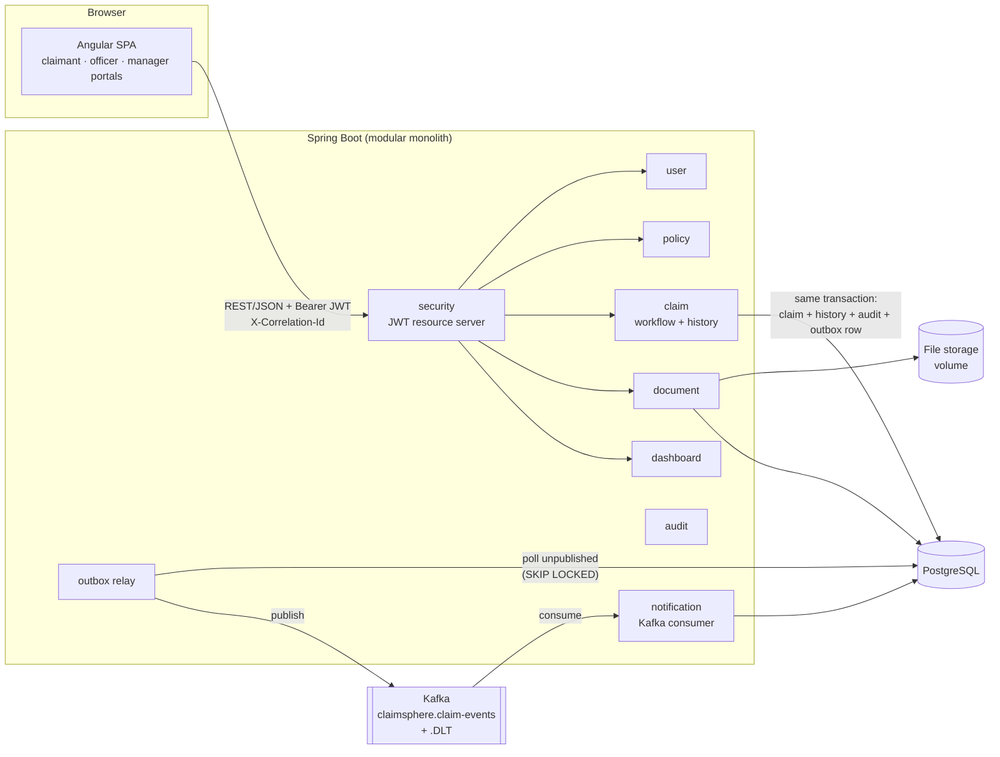
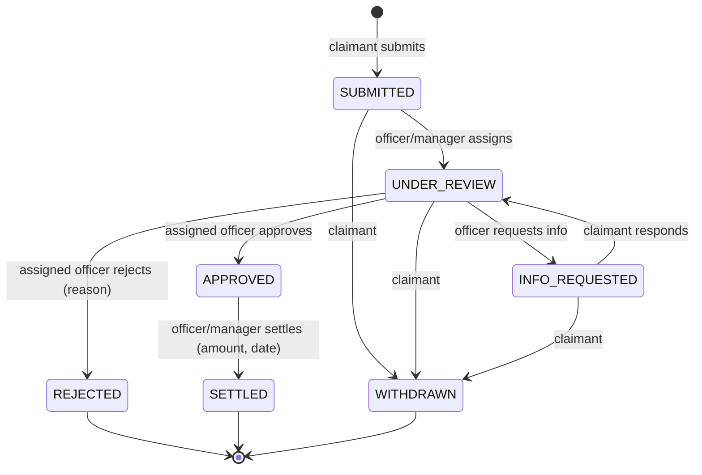

# ClaimSphere Architecture

## 1. Overview

ClaimSphere is a **modular monolith**: one deployable Spring Boot application with explicit module boundaries, an Angular SPA, PostgreSQL and Kafka. REST handles everything a user waits for. Kafka carries domain events to asynchronous consumers (currently notifications).

### Why REST and Kafka

| REST (synchronous) | Kafka (asynchronous) |
|---|---|
| Login, submit claim, assign, approve, settle | `CLAIM_*` lifecycle events after commit |
| Claim details, queues, dashboard queries | Notifications (idempotent consumer) |
| Validation and authorisation feedback the user waits for | Future consumers such as analytics, fraud scoring and email/SMS, added without touching the claim module |

## 2. Backend modules (`com.claimsphere`)

| Module | Responsibility |
|---|---|
| `common` | Shared enums (Market, CurrencyCode), RFC 7807 exception handler, paging, Clock/OpenAPI/Kafka config, correlation-ID filter |
| `security` | Stateless JWT (Nimbus HS256), `CurrentUser` resolution |
| `user` | Registration, login, claimant profiles, admin provisioning, officer directory |
| `policy` | Policy creation and role-scoped queries |
| `claim` | Submission, workflow, assignments, assessments, decisions, information requests, status history, event publication |
| `document` | Document metadata; `FileStorage` abstraction with a local adapter |
| `dashboard` | Manager metrics: grouped aggregation per status, market and currency |
| `audit` | Append-only audit log and query API |
| `outbox` | Transactional outbox table and Kafka relay |
| `notification` | Kafka consumer and notification API |
| `bootstrap` | Demo data seeder (`demo` profile only) |

**Layering inside a module:** `domain → repository → service → web (+ dto)`.

**Controllers stay thin.** They validate input, resolve the current user, delegate to a service, and return DTOs. No JPA entity is ever serialised directly.

**The claim module has a clear split of responsibilities:**

| Class | Responsibility |
|---|---|
| `Claim` | Aggregate. Enforces the state machine and amount rules: approved ≤ estimated loss, settled ≤ approved, and the conditions for edits and reassignment |
| `ClaimStatus` | The single definition of allowed transitions |
| `ClaimSubmissionService` | Claimant commands |
| `ClaimWorkflowService` | Officer and manager commands |
| `ClaimQueryService` | Role-scoped reads, filtering through JPA Specifications |
| `ClaimAccessPolicy` + `ClaimLookup` | Ownership checks (404) and assigned-officer checks (403) |
| `ClaimTransitionRecorder` | The one place a change becomes durable: save, status history, audit record and outbox event, all in the caller's transaction |

**Allowed module dependencies:**
- `notification` depends only on the `ClaimEvent` contract, never on claim internals.
- `document` and `dashboard` read claims through the claim module's services and entities.

## 3. Claim lifecycle

**Actions that don't change status** (assessment notes, reassignment, priority, detail edits) are still recorded in the audit log, and in the assignment history where relevant.

## 4. Security

**Authentication.** The Spring Security OAuth2 resource server verifies each JWT's signature, expiry and issuer. There is no hand-written JWT filter.
- The HS256 key comes from `JWT_SECRET`; a key shorter than 32 bytes fails startup.
- Roles are read from the database at login. Registration always creates CLAIMANT, whatever the request says.

**Authorisation has two layers:**
1. `@PreAuthorize` role checks on controllers.
2. Service-level checks:
   - Claimants get **404** for claims and policies they don't own, so other users' IDs can't be discovered.
   - Only the **assigned officer** can assess, request information, approve or reject.
   - Settlement is limited to the assigned officer or a manager.
   - Internal assessment notes are visible to staff only.
   - The manager dashboard is restricted to MANAGER.

**Data protection:**
- Passwords are hashed with BCrypt.
- Login always performs a hash comparison, even for unknown emails, so response timing doesn't reveal whether an email exists.
- Hashes and tokens are never logged or returned in responses.

**Uploads:**
- The file type is detected from the file's leading bytes, not the client's claim.
- Uploads are limited to 10 MB and stored under server-generated keys, with path-traversal protection.
- Downloads are always sent as attachments with `nosniff`.

**Frontend:**
- The token is kept in `sessionStorage` and the session ends automatically when the token expires.
- nginx sends a strict CSP and security headers.
- Route guards are a UX convenience only; the backend is the authority.

## 5. Reliability and messaging

**Transactional outbox.** The event row is inserted in the same transaction as the claim change. `OutboxRelay` then polls for unpublished rows (`FOR UPDATE SKIP LOCKED`, so replicas never pick the same row) and publishes them in creation order.
- If Kafka is down, events wait in the table and are published once it recovers.
- Delivery is **at least once**.

**Idempotent consumer.** Notifications are unique per `(event_id, user_id)`.
- Failed messages are retried 3 times at 1-second intervals, then sent to `claimsphere.claim-events.DLT`.
- Messages that can't be deserialised go to the DLT immediately.

**Optimistic locking.** `claims.version` turns concurrent updates into a 409 instead of a lost update. This is also how conflicting assignments are caught.

**Idempotent submission.** A unique `(claimant_id, submission_key)` turns client retries into "return the existing claim". The frontend generates one key per form.

**No exactly-once claims.** Kafka transactions alone wouldn't make business processing exactly-once, so the design relies on idempotency instead.

## 6. Observability

- **Correlation ID.** The `X-Correlation-Id` header is accepted or generated, then carried through the request MDC, audit records, outbox rows and Kafka headers, and into the consumer's MDC. The Angular app sends a new ID with every API call.
- **Logs.** Structured ECS JSON (`LOG_FORMAT=ecs`). Log lines carry identifiers only, never personal data or credentials.
- **Health.** Actuator health groups for liveness and readiness back the Kubernetes probes.

## 7. Frontend

Angular 21: standalone components, zoneless change detection, signals, lazy routes and Angular Material.

| Folder | Contents |
|---|---|
| `core/` | Models, HTTP services, interceptors (correlation ID, auth, errors), guards (auth, role, role-home), pure rule functions (`claim-actions`, `claim-stats`) |
| `shared/` | Page state (loading, error, empty), claim table, status and priority chips |
| `auth/` | Login, register |
| `claimant/` | Dashboard, report incident (with documents) |
| `officer/` | Workspace with assigned and unassigned queues |
| `manager/` | Dashboard |
| `claims/` | List and detail (action panel, documents, timeline) |
| `policies/`, `notifications/` | Supporting pages |

Each role lands on its own portal after login. Workflow commands are typed (`ClaimCommand`) and executed by `ClaimWorkflowService`, so components hold no workflow logic.

## 8. Deployment

| Target | Notes |
|---|---|
| Docker | Multi-stage builds for both images, running as non-root (backend UID 10001, `nginx-unprivileged`) |
| Compose | PostgreSQL 16, KRaft Kafka, backend and frontend, with healthchecks and persistent volumes for the database and uploads |
| Kubernetes | Kustomize manifests in `infrastructure/kubernetes`: namespace, ConfigMap, Secret generated from a git-ignored env file, PostgreSQL and Kafka StatefulSets, backend Deployment with probes, limits and an uploads PVC, frontend Deployment, Services, Ingress. See the README for Minikube steps |
| CI | GitHub Actions: backend tests against PostgreSQL, frontend tests and build, Docker image builds, Kustomize rendering and kubeconform validation |

## 9. Architecture decision records

| ADR | Decision |
|---|---|
| [0001](adr/0001-modular-monolith.md) | Modular monolith instead of microservices |
| [0002](adr/0002-transactional-outbox.md) | Transactional outbox for Kafka publication |
| [0003](adr/0003-currency-aware-liability.md) | Liability reported per currency, never summed |
| [0004](adr/0004-document-storage.md) | File storage abstraction with a local adapter |
| [0005](adr/0005-test-database-strategy.md) | H2 locally, PostgreSQL in CI |
| [0006](adr/0006-framework-versions.md) | Spring Boot 3.5 and Angular 21 |
