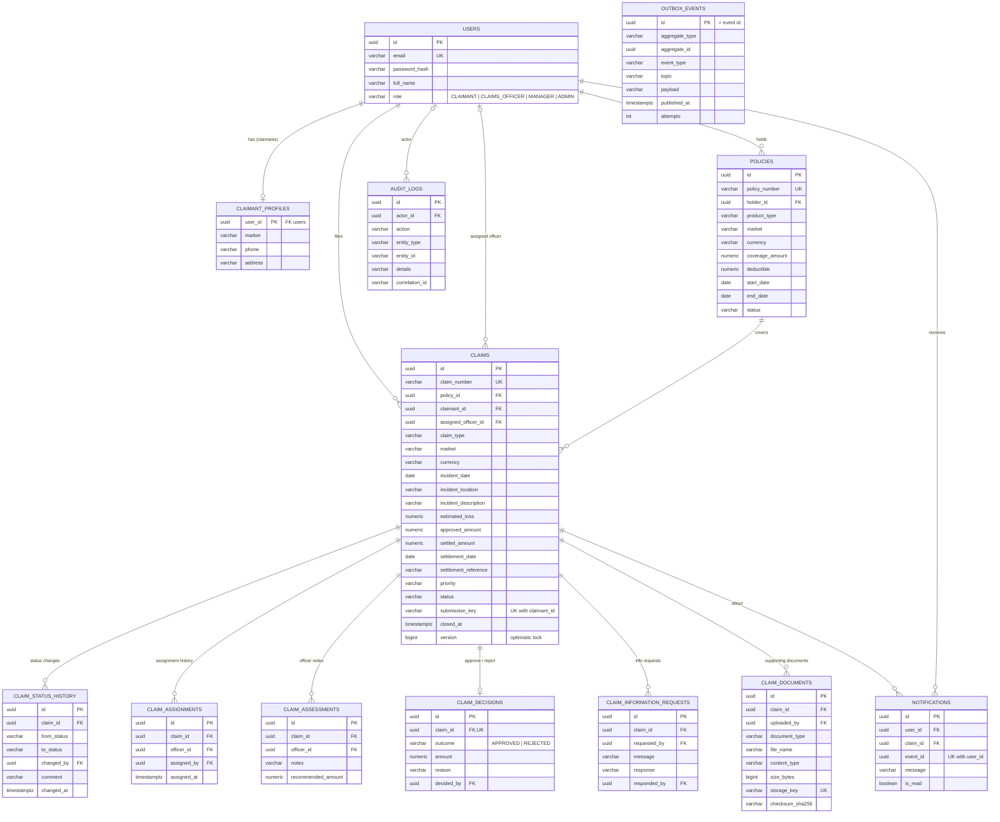

# Database Design

PostgreSQL 16, managed by Flyway (`backend/src/main/resources/db/migration`). Hibernate runs with `ddl-auto: validate`, so the entities must match the migrations exactly.

## Migrations

| Version | Purpose |
|---|---|
| V1 | `users` |
| V2 | `policies` |
| V3 | `claims`, `claim_status_history`, `claim_number_seq` |
| V4 | `notifications` |
| V5 | Roles CLAIMS_OFFICER and MANAGER, `claimant_profiles`, market and currency on policies and claims, the INFO_REQUESTED state, settlement fields, idempotent submission, plus the `claim_assignments`, `claim_assessments`, `claim_decisions` and `claim_information_requests` tables |
| V6 | `audit_logs`, `outbox_events` |
| V7 | `claim_documents` |

V5 changes the schema instead of editing V1–V4 because those were already pushed. That's the normal Flyway rule: never edit an applied migration.

## Entity–relationship diagram

## Design decisions

- **Claimant is a role plus a profile.** A claimant is a `users` row with role CLAIMANT and a 1:1 `claimant_profiles` row for contact details and home market. This avoids duplicating identity data.
- **The current state and its history are kept together.**
  - `claims.assigned_officer_id` points to the current officer, and `claim_assignments` keeps every assignment and reassignment.
  - `claims.approved_amount` holds the current approved figure that the liability totals use, and `claim_decisions` records who decided, when and why.
- **Market, currency and claim type are copied onto each claim.** They're stamped from the policy at submission. The claim keeps the terms it was filed under, and dashboard queries can group without joining `policies`.
- **Money.**
  - Amounts use `NUMERIC(15,2)` columns, mapped to `BigDecimal` with HALF_UP rounding.
  - Each amount sits next to a `currency` column.
  - Amounts in different currencies are never summed.
- **Time.** Timestamps are `TIMESTAMP WITH TIME ZONE`, with Hibernate's JDBC time zone set to UTC. Business dates (incident, settlement) are `DATE`.
- **Concurrency.** `claims.version` enables optimistic locking: two officers acting on the same claim at once get a 409, never a lost update.
- **Integrity.** Every foreign key is declared. CHECK constraints guard enums, positive amounts and a valid policy period. `ck_decisions_content` requires an amount for approvals and a reason for rejections.
- **Idempotency.**
  - `UNIQUE(claimant_id, submission_key)` stops duplicate claim submissions.
  - `UNIQUE(event_id, user_id)` stops duplicate notifications.
- **Documents.** Only metadata is stored in the database. The file content is held by the `FileStorage` adapter, keyed by a server-generated `storage_key`.
- **Sequences.** Claim numbers (`CLM-<year>-<6 digits>`) come from `claim_number_seq`, so they're unique even under concurrent submissions.

## Indexes and why

| Index | Supports |
|---|---|
| `uk_claims_number` | Lookup by claim number |
| `idx_claims_status_created (status, created_at DESC)` | Status-filtered, newest-first lists, and dashboard status counts |
| `idx_claims_market` | Market filters and per-market aggregation |
| `idx_claims_officer` | Officer queue ("assigned to me") and workload |
| `idx_claims_created_at` | Submission date-range filters and ageing |
| `idx_claims_claimant`, `idx_claims_policy` | Claimant's own claims; FK joins |
| `idx_history_claim (claim_id, changed_at)` | Claim timeline |
| `idx_assignments_claim`, `idx_assessments_claim`, `idx_info_requests_claim`, `idx_documents_claim` | Claim detail sections |
| `idx_notifications_user (user_id, is_read, created_at DESC)` | Unread-first notification list |
| `idx_audit_logs_entity (entity_type, entity_id, created_at)` | Audit trail of one entity |
| `idx_outbox_pending (published_at, created_at)` | Relay polling of unpublished events, oldest first |
| `idx_policies_holder`, `idx_policies_market` | Claimant's policies; market reporting |

## Test databases

Integration tests run Flyway against in-memory H2 in PostgreSQL mode, which keeps tests fast and Docker-free. CI runs the same suite against a real PostgreSQL 16 service container by setting `TEST_DB_URL`, `TEST_DB_USERNAME` and `TEST_DB_PASSWORD`.

The migrations stick to SQL that both engines accept: no `gen_random_uuid()`, no partial indexes, and `VARCHAR` instead of `TEXT`.
