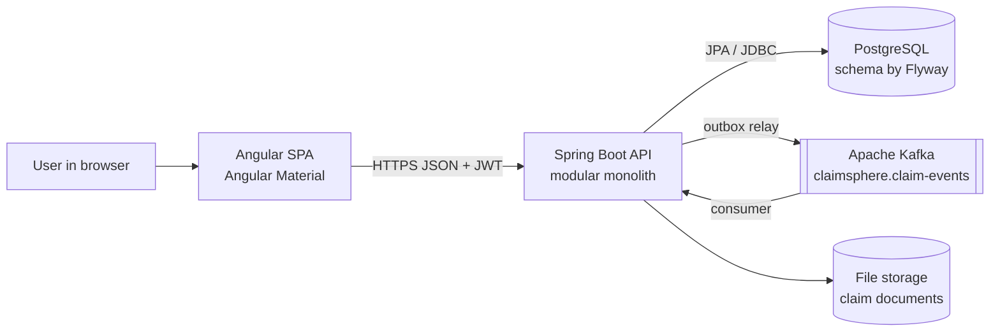
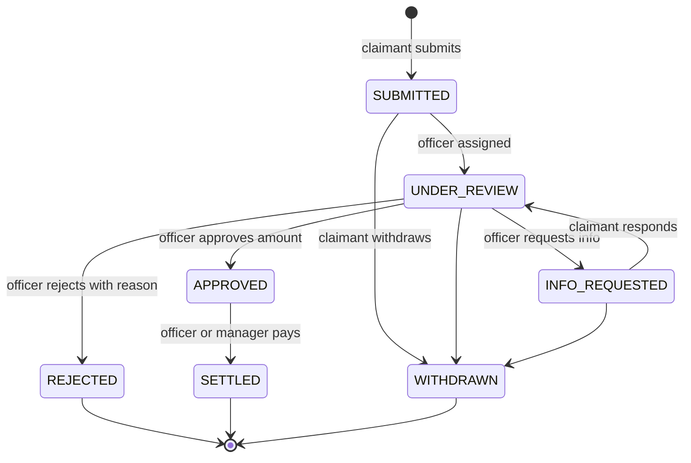
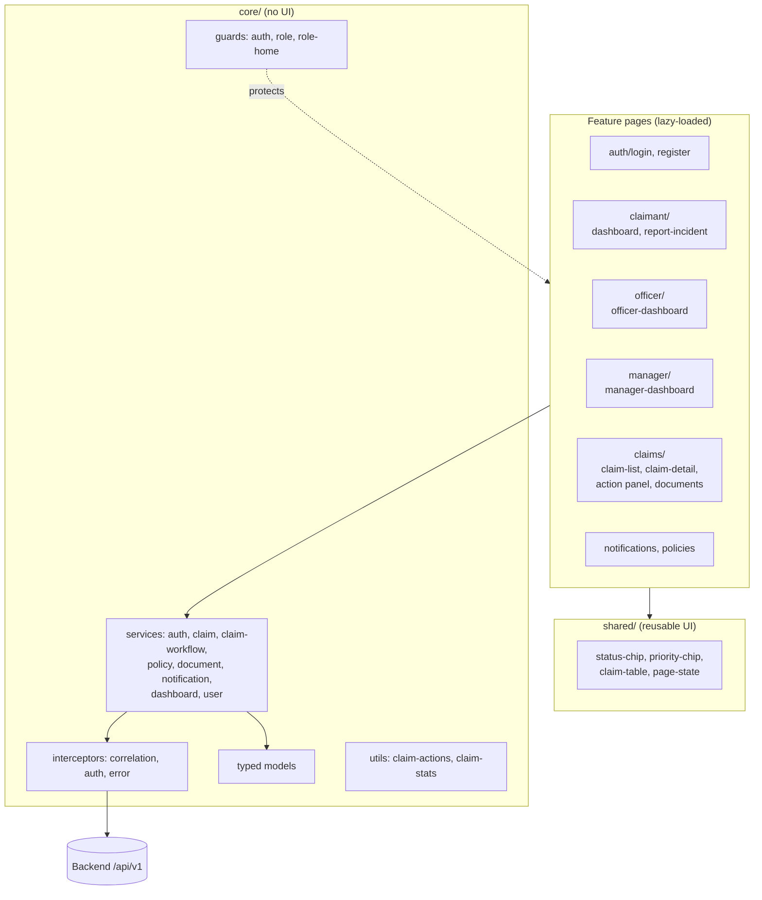
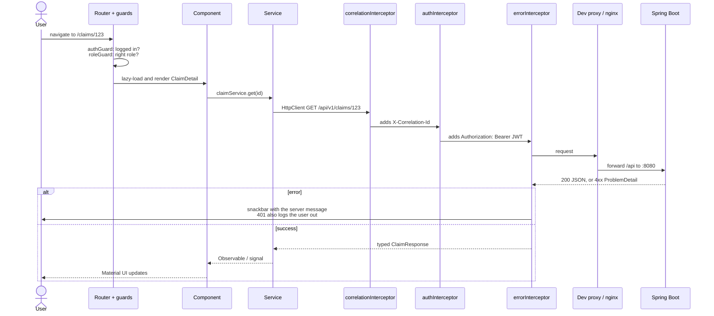
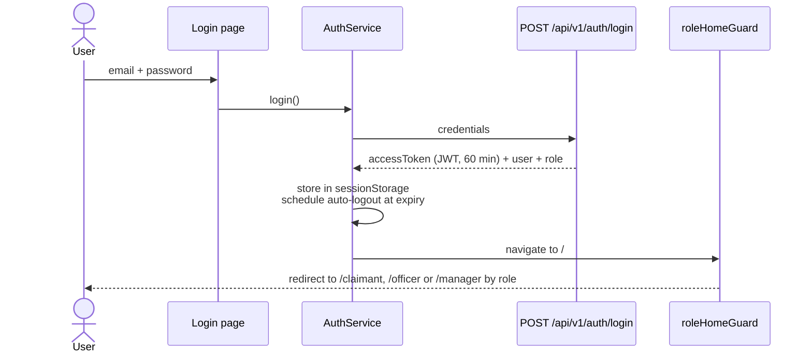
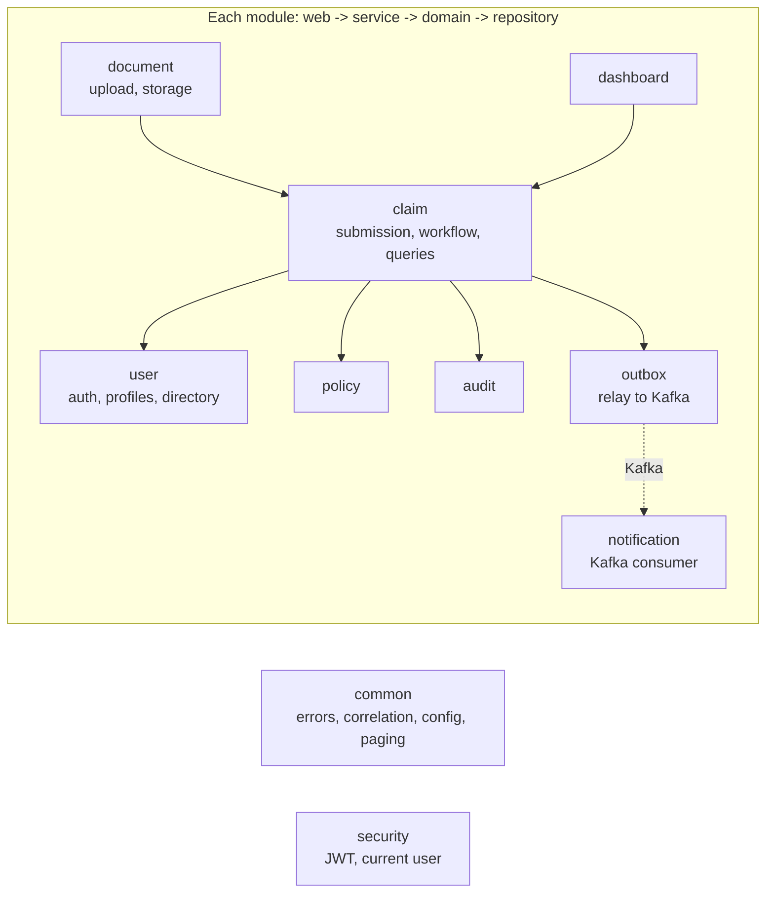
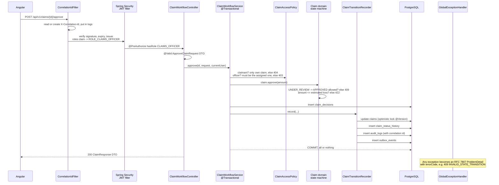
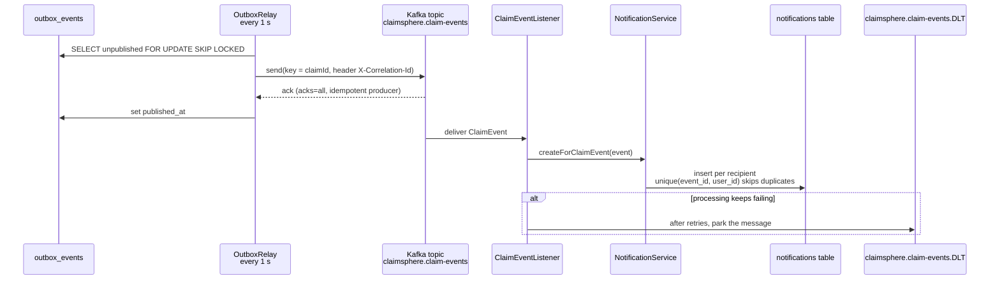
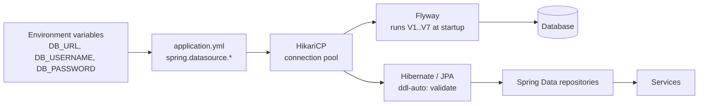
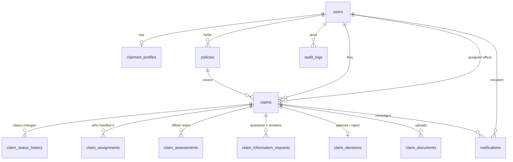

# ClaimSphere: End-to-End Presentation Guide

This guide walks through the whole platform: what each layer uses, how a request flows through the frontend and the backend, how the database is connected, and a set of test cases you can run live in front of a client.

Every test case in [section 6](#6-walkthrough-as-test-cases) was executed against the running application on 15 Nov 2026. The expected results are what actually came back, not what the design intends.

---

## 1. The big picture



ClaimSphere is a claims platform for an APAC insurer. Claimants report incidents against their policies. Claims officers review, request information, approve or reject, and settle. Managers watch the portfolio on a dashboard. Every change is audited and produces an event that drives notifications.

### Roles

| Role | Lands on | Can do |
|---|---|---|
| Claimant | `/claimant` | Report an incident, see **only their own** claims, answer information requests, upload documents, withdraw |
| Claims officer | `/officer` | Pick up claims, assess, request information, approve or reject, settle |
| Manager | `/manager` | Dashboard, assign or reassign claims to officers, settle, change priority, read the audit log |
| Admin | – | Create users and policies, read the audit log |

### Claim lifecycle



The allowed moves are defined once, in [ClaimStatus.java](../backend/src/main/java/com/claimsphere/claim/domain/ClaimStatus.java). Any other move is refused with **409 Conflict**.

---

## 2. Tech stack by phase

| Phase | Technology | Why it was chosen | Where it lives |
|---|---|---|---|
| **UI** | Angular 21 (standalone components, signals, zoneless), TypeScript, Angular Material | Enterprise standard; typed end to end; ready-made accessible components | [frontend/src/app](../frontend/src/app) |
| **UI routing and security** | Lazy-loaded routes, `authGuard`, `roleGuard`, HTTP interceptors | Each portal is downloaded only when needed; the token is attached in one place | [app.routes.ts](../frontend/src/app/app.routes.ts), [core/](../frontend/src/app/core) |
| **UI tests** | Vitest (via Angular CLI) | Fast unit tests for services, guards and helpers | `*.spec.ts` |
| **API** | Java 21, Spring Boot 3.5, Spring Web, Bean Validation | LTS Java; Spring is the enterprise default | [backend/src/main/java/com/claimsphere](../backend/src/main/java/com/claimsphere) |
| **API docs** | springdoc OpenAPI / Swagger UI | Live, always-in-sync contract | `http://localhost:8080/swagger-ui.html` |
| **Security** | Spring Security, OAuth2 Resource Server, JWT (HS256), BCrypt | Stateless tokens scale horizontally; passwords never stored in clear | [security/](../backend/src/main/java/com/claimsphere/security) |
| **Persistence** | Spring Data JPA (Hibernate), HikariCP pool, PostgreSQL 16 | Repositories remove boilerplate; Postgres is robust and free | `*/repository/*` |
| **Schema** | Flyway (7 versioned SQL migrations) | Schema is versioned with the code and reproducible everywhere | [db/migration](../backend/src/main/resources/db/migration) |
| **Messaging** | Apache Kafka (KRaft), Spring Kafka, transactional outbox, retry + dead-letter topic | Decouples notifications from the claim transaction; no lost or phantom events | [outbox/](../backend/src/main/java/com/claimsphere/outbox), [KafkaConfig.java](../backend/src/main/java/com/claimsphere/common/config/KafkaConfig.java) |
| **Observability** | Structured JSON logs (ECS), `X-Correlation-Id` on every request and event, Actuator health probes | One ID traces a click through the API, the DB audit log and Kafka | [CorrelationIdFilter.java](../backend/src/main/java/com/claimsphere/common/web/CorrelationIdFilter.java) |
| **Backend tests** | JUnit 5, Mockito, Spring Boot Test, MockMvc, H2, EmbeddedKafka | 88 tests: domain rules, services, full HTTP workflows and authorisation | [backend/src/test](../backend/src/test) |
| **Packaging** | Docker multi-stage builds (Temurin JRE; nginx for the SPA) | Small, non-root runtime images | `backend/Dockerfile`, `frontend/Dockerfile` |
| **Local stack** | Docker Compose: postgres, kafka, backend, frontend | One command runs everything | [docker-compose.yml](../docker-compose.yml) |
| **Cluster** | Kubernetes manifests (Deployments, Services, StatefulSets, ConfigMap, Secret, PVC, Ingress) | Production-shaped deployment; validated with kubeconform | [infrastructure/kubernetes](../infrastructure/kubernetes) |
| **CI** | GitHub Actions | Builds, tests on real PostgreSQL, builds images, validates manifests | [.github/workflows/ci.yml](../.github/workflows/ci.yml) |

---

## 3. Frontend flow

### 3.1 How the Angular app is organised



Business rules stay out of components. Components call **services**, services call the API, and the **interceptors** handle cross-cutting concerns. A rule such as "which buttons can this role press in this status" lives in [claim-actions.ts](../frontend/src/app/core/utils/claim-actions.ts).

### 3.2 What happens when a user clicks something



### 3.3 Login and session



**Talking points**
- The token is in `sessionStorage`, so it's cleared when the tab closes, and the app logs out automatically when the JWT expires.
- The guards are a convenience only. **The backend re-checks every permission**, so hiding a button is never the security.
- In development `ng serve` proxies `/api` to `:8080` ([proxy.conf.json](../frontend/proxy.conf.json)). In Docker and Kubernetes nginx does the same ([nginx.conf](../frontend/nginx.conf)), so the browser always talks to one origin.

---

## 4. Backend flow

### 4.1 Modules (modular monolith)



One deployable, with clear package boundaries. Each module could later be split into its own service, because modules talk to each other through services and events rather than through each other's tables.

### 4.2 Life of a request: "officer approves a claim"



### 4.3 Events: from the database to a notification



**Why an outbox?** If the API sent to Kafka directly inside the transaction, a database rollback could leave a "claim approved" event for a claim that was never approved, or a Kafka outage could lose the event. With the outbox, the event row commits **in the same transaction** as the claim, and the relay delivers it afterwards, at least once. Because the consumer ignores duplicates, the result is effectively exactly once.

**Why the claim ID as the Kafka key?** All events for one claim go to the same partition, so they're processed in order.

### 4.4 HTTP status codes the API uses

| Code | Meaning | Example `errorCode` |
|---|---|---|
| 200 / 201 | OK / created | |
| 400 | The request itself is malformed | `VALIDATION_FAILED` with `fieldErrors` |
| 401 | Not logged in, bad credentials, or expired token | `INVALID_CREDENTIALS` |
| 403 | Logged in, but this role or user may not do this | `ACCESS_DENIED` |
| 404 | Doesn't exist, **or belongs to another claimant** (so IDs can't be probed) | `NOT_FOUND` |
| 409 | Not allowed in the current state, or a concurrent edit | `INVALID_STATE_TRANSITION`, `CLAIM_ALREADY_ASSIGNED`, `CONCURRENT_MODIFICATION` |
| 422 | Valid request, but it breaks a business rule | `AMOUNT_EXCEEDS_COVERAGE`, `INCIDENT_DATE_IN_FUTURE`, `SETTLED_AMOUNT_EXCEEDS_APPROVED` |

---

## 5. The database: how it's connected and how to check it yourself

### 5.1 How the connection works



1. **Configuration.** [application.yml](../backend/src/main/resources/application.yml) reads `DB_URL`, `DB_USERNAME` and `DB_PASSWORD` from the environment. No credentials are in the code.
2. **Connection pool.** Spring Boot creates a HikariCP pool, so connections are reused instead of opened per request.
3. **Flyway runs first.** At startup it compares `flyway_schema_history` with the files in `db/migration` and applies any new ones (`V1__create_users.sql` to `V7__create_claim_documents.sql`).
4. **Hibernate validates.** `ddl-auto: validate` means Hibernate **never changes** the schema; it only checks that entities match the tables Flyway created. If they don't, the app refuses to start.
5. **Repositories.** Interfaces like `ClaimRepository extends JpaRepository` provide SQL. Complex filters use JPA Specifications ([ClaimSpecifications.java](../backend/src/main/java/com/claimsphere/claim/repository/ClaimSpecifications.java)).
6. **Times and money.** All timestamps are `TIMESTAMP WITH TIME ZONE` stored in UTC (`hibernate.jdbc.time_zone: UTC`). All money is `NUMERIC(15,2)` mapped to `BigDecimal`, never floating point.

### 5.2 Which database is used where

| How you run it | Database | Connection |
|---|---|---|
| **Right now on this laptop** (`mvnw spring-boot:test-run`, no Docker) | H2 in-memory, in PostgreSQL compatibility mode | `jdbc:h2:mem:claimsphere-dev`, user `sa`, no password. Data is lost when the backend stops |
| Docker Compose | PostgreSQL 16 container `postgres` | `jdbc:postgresql://postgres:5432/claimsphere`, credentials from `.env` |
| Kubernetes | PostgreSQL StatefulSet with a persistent volume | URL from a ConfigMap, credentials from a Secret |
| CI pipeline | PostgreSQL service container | Integration tests run against real PostgreSQL |

The **same Flyway scripts** create the schema in every case.

### 5.3 Check the database manually (local run, what's running now)

1. Open **http://localhost:8082** (the H2 web console; it only accepts connections from this machine).
2. Fill in the form:
   - **Driver Class:** `org.h2.Driver`
   - **JDBC URL:** `jdbc:h2:mem:claimsphere-dev;MODE=PostgreSQL;DATABASE_TO_LOWER=TRUE;DEFAULT_NULL_ORDERING=HIGH;DB_CLOSE_DELAY=-1`
   - **User Name:** `sa`
   - **Password:** leave empty
3. Click **Connect**. The tables appear on the left. Paste any query below and click **Run**.

> If you get "Database not found", the URL was mistyped. Copy it exactly; it must point at the database the backend already created.

### 5.4 Check the database manually (Docker Compose / PostgreSQL)

```bash
docker compose exec postgres psql -U claimsphere -d claimsphere
\dt                      -- list tables
\d claims                -- columns, indexes, foreign keys
```

Or connect any SQL client (DBeaver, pgAdmin) to `localhost:5432`, database `claimsphere`, with the username and password from your `.env`.

### 5.5 Tables at a glance



`outbox_events` has no foreign key on purpose: it is a technical queue, and `aggregate_id` just holds the claim ID. Full column-level details are in [database-design.md](database-design.md).

### 5.6 Useful queries for the demo

```sql
-- 1. Schema was built by Flyway
SELECT version, description, success FROM flyway_schema_history ORDER BY installed_rank;

-- 2. All claims with owner, status and money
SELECT c.claim_number, c.status, c.claim_type, c.market, c.currency,
       c.estimated_loss, c.approved_amount, c.settled_amount, u.email AS claimant
FROM claims c JOIN users u ON u.id = c.claimant_id
ORDER BY c.claim_number;

-- 3. Passwords are BCrypt hashes, never plain text
SELECT email, role, LEFT(password_hash, 7) AS hash_prefix FROM users ORDER BY role;

-- 4. Full status history of one claim (who did what, when)
SELECT h.from_status, h.to_status, u.email AS changed_by, h.comment, h.changed_at
FROM claim_status_history h
JOIN claims c ON c.id = h.claim_id
JOIN users u ON u.id = h.changed_by
WHERE c.claim_number = 'CLM-2026-000006'
ORDER BY h.changed_at;

-- 5. Audit log for that claim, with the correlation ID of each request
SELECT a.action, u.email, a.details, a.correlation_id, a.created_at
FROM audit_logs a
JOIN users u ON u.id = a.actor_id
JOIN claims c ON CAST(c.id AS VARCHAR) = a.entity_id
WHERE c.claim_number = 'CLM-2026-000006'
ORDER BY a.created_at;

-- 6. Outbox: every event was written, then published to Kafka
SELECT o.event_type, o.topic, o.attempts, o.published_at, o.last_error
FROM outbox_events o JOIN claims c ON c.id = o.aggregate_id
WHERE c.claim_number = 'CLM-2026-000006'
ORDER BY o.created_at;

-- 7. Notifications created by the Kafka consumer
SELECT u.email, n.type, n.message, n.is_read
FROM notifications n
JOIN users u ON u.id = n.user_id
JOIN claims c ON c.id = n.claim_id
WHERE c.claim_number = 'CLM-2026-000006'
ORDER BY n.created_at;

-- 8. Anything stuck in the outbox? (should be 0 rows)
SELECT event_type, attempts, last_error FROM outbox_events WHERE published_at IS NULL;
```

Replace `CLM-2026-000006` with whatever claim number you create during the demo. Claim numbers continue from the seeded `CLM-2026-000005`.

---

## 6. Walkthrough as test cases

**Setup:** UI at http://localhost:4200, Swagger at http://localhost:8080/swagger-ui.html, H2 console at http://localhost:8082.
All demo accounts use the password `ClaimSphere#2026` (local run only; set with `DEMO_PASSWORD`).

Seeded data:

| Account | Role | Seeded data |
|---|---|---|
| `claimant@claimsphere.local` | Claimant, Singapore | CLM-2026-000001 motor, SUBMITTED; CLM-2026-000005 travel, SETTLED |
| `claimant2@claimsphere.local` | Claimant, India | CLM-2026-000002 health, UNDER_REVIEW; CLM-2026-000003, INFO_REQUESTED |
| `claimant3@claimsphere.local` | Claimant, Australia | CLM-2026-000004 property, APPROVED |
| `officer@claimsphere.local`, `officer2@claimsphere.local` | Claims officers | |
| `manager@claimsphere.local` | Manager | |
| `admin@claimsphere.local` | Admin | |

Run the cases in order; later ones use the claim created in CLM-01.

### A. Authentication

| ID | As | Steps | Expected | Verified |
|---|---|---|---|---|
| AUTH-01 | anyone | Log in with a wrong password | Stays on login; snackbar "Invalid email or password"; API **401** | ✅ |
| AUTH-02 | anyone | Without logging in, open http://localhost:4200/claims | Redirected to `/login`; API without a token returns **401** | ✅ |
| AUTH-03 | claimant | Log in as `claimant@claimsphere.local` from the login page | Lands on **/claimant** dashboard with own claims only. If you were sent to login from a deep link, you go back to that page instead | ✅ |
| AUTH-04 | officer, manager | Log in as each | Officer lands on **/officer**, manager on **/manager** | ✅ |
| AUTH-05 | claimant | While logged in, type `/manager` into the address bar | Sent back to `/claimant` (role guard) | ✅ |

**DB check:** query 3. Every password is a `$2a$10$` BCrypt hash.

### B. Claim submission (claimant)

| ID | As | Steps | Expected | Verified |
|---|---|---|---|---|
| CLM-01 | claimant | **Report incident**: choose the travel policy, today's date, location "Marina Bay, Singapore", description, estimated loss **3200.50**, submit | New claim **CLM-2026-000006**, status **SUBMITTED**, currency SGD from the policy; API **201** | ✅ |
| CLM-02 | claimant (API) | Re-send the same submission with the same `Idempotency-Key` header | API **200** with the **same** claim; no duplicate row | ✅ |
| CLM-03 | claimant | Submit with an empty location and a negative amount | Field errors shown; API **400** `VALIDATION_FAILED` | ✅ |
| CLM-04 | claimant | Submit with an incident date in the future | API **422** `INCIDENT_DATE_IN_FUTURE` | ✅ |
| CLM-05 | claimant | Submit an amount larger than the policy coverage (travel coverage is SGD 10,000) | API **422** `AMOUNT_EXCEEDS_COVERAGE` | ✅ |

**DB check:** query 2 shows the new row; query 6 shows one `CLAIM_SUBMITTED` outbox event; query 7 shows the "has been submitted" notification.

### C. Security and data isolation

| ID | As | Steps | Expected | Verified |
|---|---|---|---|---|
| SEC-01 | claimant2 | Open claimant 1's claim by URL `/claims/<id of CLM-2026-000006>` | "Not found"; API **404**, not 403, so other customers' claim IDs can't be confirmed | ✅ |
| SEC-02 | claimant | Call `POST /claims/{id}/approve` in Swagger with the claimant token | **403** `ACCESS_DENIED`. A claimant can't approve their own claim even by calling the API directly | ✅ |
| SEC-03 | claimant | Call `GET /dashboard/manager` | **403** | ✅ |
| SEC-04 | officer | Try to approve CLM-2026-000006 before anyone is assigned | **403**: only the **assigned** officer may decide | ✅ |

### D. Officer workflow (the main demo)

| ID | As | Steps | Expected | Verified |
|---|---|---|---|---|
| WF-01 | officer | **/officer** queue, open CLM-2026-000006, **Assign to me** | Status **UNDER_REVIEW**; claimant notified | ✅ |
| WF-02 | officer | Assign it again | **409** `CLAIM_ALREADY_ASSIGNED` | ✅ |
| WF-03 | officer | **Add assessment**: notes + recommended amount 3000 | Assessment saved (**201**); status unchanged | ✅ |
| WF-04 | officer | **Request information**: "Please upload the police report" | Status **INFO_REQUESTED** | ✅ |
| WF-05 | claimant | Log in, open the claim, **Provide information**, optionally upload a PDF or image | Status back to **UNDER_REVIEW**; officer notified | ✅ |
| WF-06 | officer | **Approve** with amount 5000 (more than the 3200.50 estimate) | **422** `APPROVED_AMOUNT_EXCEEDS_ESTIMATED_LOSS` | ✅ |
| WF-07 | officer | **Approve** 3000, comment "Within policy" | Status **APPROVED**, approved 3000.00 SGD | ✅ |
| WF-08 | claimant | Try to **withdraw** the approved claim | **409**: approved claims can't be withdrawn | ✅ |
| WF-09 | officer | **Settle** 3500 | **422** `SETTLED_AMOUNT_EXCEEDS_APPROVED` | ✅ |
| WF-10 | officer | **Settle** 3000, reference PAY-0001 | Status **SETTLED** (final) | ✅ |
| WF-11 | officer | Settle again | **409**: SETTLED is a terminal state | ✅ |
| WF-12 | claimant | Open the claim's **History** tab | Six steps: →SUBMITTED, →UNDER_REVIEW, →INFO_REQUESTED, →UNDER_REVIEW, →APPROVED, →SETTLED | ✅ |

**DB check (the strongest part of the demo).** Run queries 4 to 7 for CLM-2026-000006. In the verification run they returned:

- **History:** 6 rows, each with who made the change and the comment.
- **Audit:** 7 rows (the 6 status changes plus the assessment), each with a **different correlation ID**, one per HTTP request.
- **Outbox:** 6 events, all `attempts = 1` and published.
- **Notifications:** 7 rows. The claimant got 5 (submitted, under review, info requested, approved, settled); the officer got 2 (assigned to you, information provided).

### E. Events and notifications

| ID | As | Steps | Expected | Verified |
|---|---|---|---|---|
| EVT-01 | claimant | Open **Notifications** after the workflow | One message per step, newest first; can mark as read | ✅ |
| EVT-02 | – | Query 8 | 0 rows: nothing stuck in the outbox | ✅ |
| EVT-03 | – | Automated test `ClaimEventConsumerFailureIntegrationTest` | A message that can't be processed lands on `claimsphere.claim-events.DLT` after retries | ✅ (automated) |

### F. Manager

| ID | As | Steps | Expected | Verified |
|---|---|---|---|---|
| MGR-01 | manager | Open **/manager** | Totals by status, **outstanding liability per currency** (SGD, INR, AUD never added together), officer workload, ageing claims | ✅ |
| MGR-02 | manager | Assign CLM-2026-000001 to `officer2` | Status UNDER_REVIEW, owner officer2 | ✅ (automated) |
| MGR-03 | manager | Reassign it to `officer` | Owner changes, status unchanged; `claim_assignments` gains a second row | ✅ (automated) |
| MGR-04 | manager | Swagger `GET /audit-logs?entityId=<claim id>` | Full audit trail | ✅ |

### G. Things the client may ask you to prove

| Question | How to show it |
|---|---|
| "What if two officers click Approve at the same time?" | `claims.version` provides optimistic locking, and `GlobalExceptionHandler` turns the losing request into **409** `CONCURRENT_MODIFICATION`. Honest note: there is no automated concurrency test for this yet. |
| "What if Kafka is down?" | The claim still saves; the event waits in `outbox_events` with `published_at = NULL` and `last_error` filled, and is sent when Kafka returns. |
| "Can a user make themselves an admin?" | `POST /auth/register` always creates a **CLAIMANT**; the role field isn't accepted. Only an admin can create staff (`/admin/users`). |
| "How do you trace a problem?" | Take the `X-Correlation-Id` from the response headers or browser dev tools, then find it in the logs and in `audit_logs.correlation_id`. |
| "Is money safe from rounding?" | `NUMERIC(15,2)` + `BigDecimal` throughout; there are no `double` values for money. |
| "How many tests?" | Backend 88 (JUnit 5, Mockito, MockMvc, H2, EmbeddedKafka); frontend 12 (Vitest); browser E2E of the full flow. Run with `cd backend; .\mvnw.cmd verify` and `cd frontend; npx ng test --watch=false`. |

---

## 7. Suggested presentation order (about 20 minutes)

1. **Problem and roles** (2 min): section 1 and the lifecycle diagram.
2. **Architecture** (3 min): the big picture, modules, and why a modular monolith rather than microservices for this scope.
3. **Live demo** (8 min): test cases CLM-01 → WF-01…WF-12 → EVT-01 → MGR-01, switching logins between claimant and officer.
4. **Prove it in the database** (3 min): H2 console, queries 4 to 7 on the claim you just created.
5. **Security** (2 min): SEC-01 (404 for another claimant's claim) and SEC-02 (403 in Swagger).
6. **Delivery** (2 min): Docker, Compose, Kubernetes, CI; then limitations.

## 8. Be upfront about limitations

- On this laptop the app runs on **H2 + embedded Kafka** because Docker isn't installed. Docker Compose, Kubernetes deployment and the PostgreSQL CI job are written and validated statically but haven't been run end to end yet.
- Documents are stored on a local volume, so the Kubernetes backend runs **one replica**. Moving to Azure Blob or S3 storage removes that limit (see [ADR 0004](adr/0004-document-storage.md)).
- Kafka delivery is at-least-once; duplicates are absorbed by the consumer's unique constraint.
- An invalid state change returns **409** rather than 400, because it conflicts with the resource's current state; the request itself is well-formed.
- There's no email/SMS delivery: notifications are in-app only.
