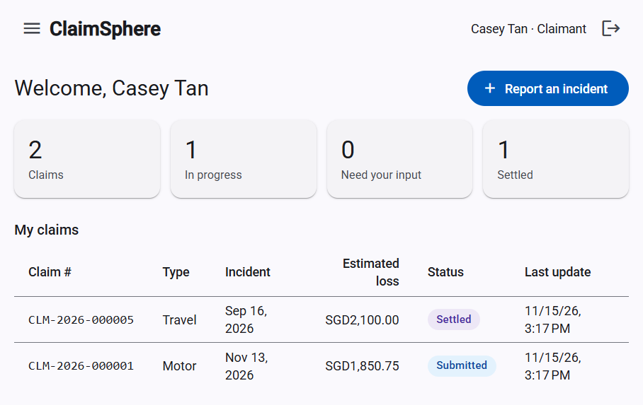
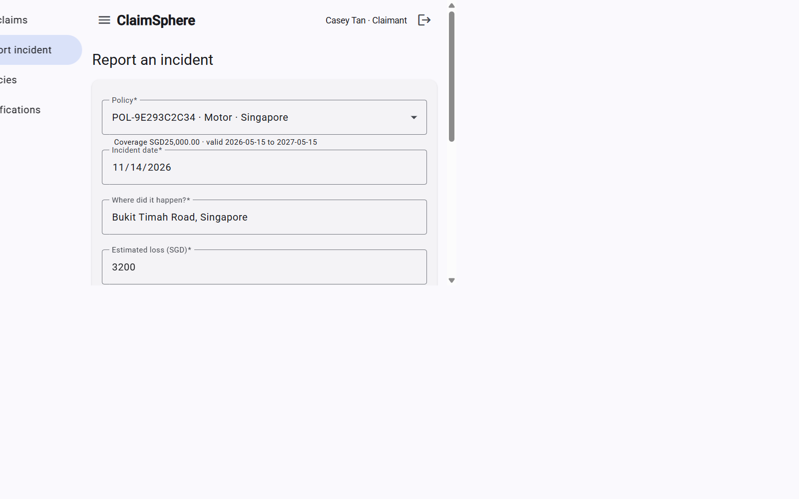
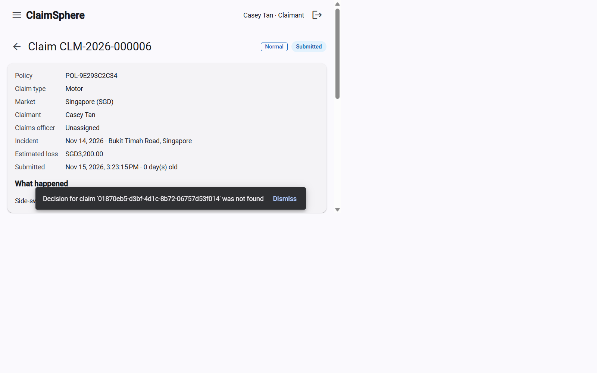
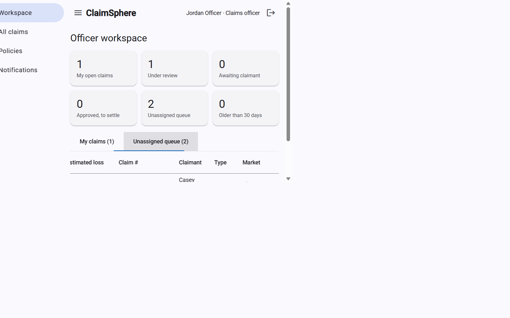
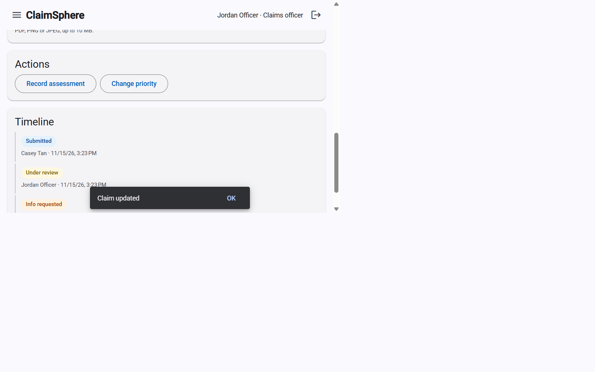
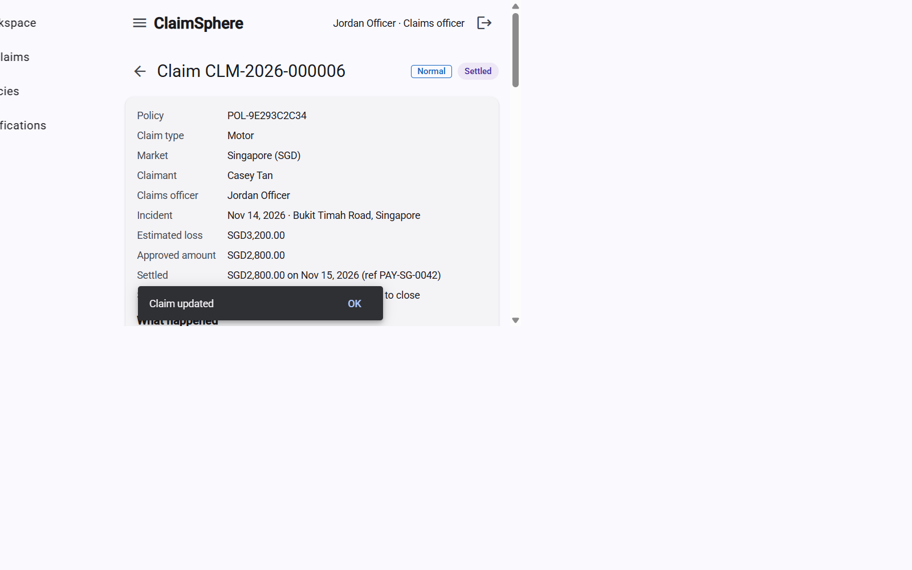
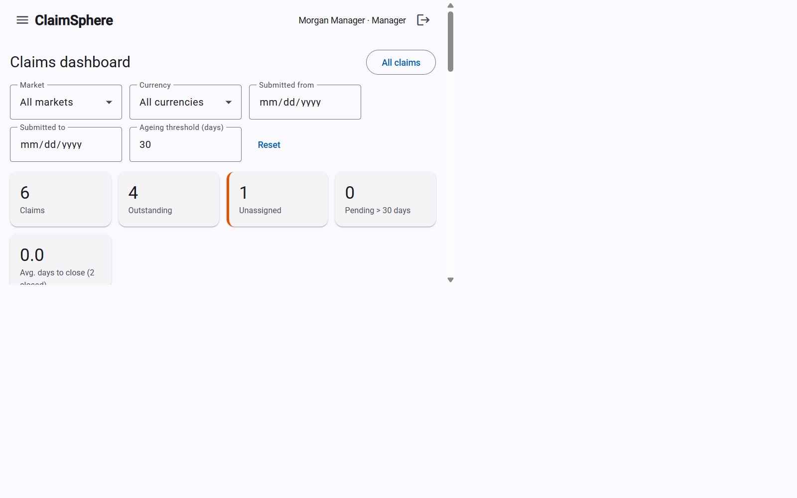
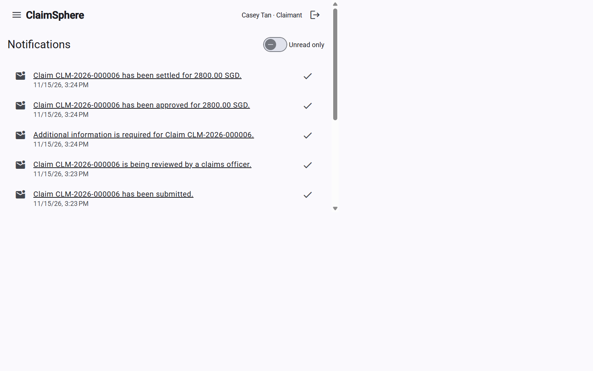

# Demo Walkthrough

This script follows the roadmap's end-to-end verification. It was executed through the UI against the Docker-free local stack (`./mvnw spring-boot:test-run` with the `demo` profile, plus `ng serve`). The screenshots in [`screenshots/`](screenshots/) were captured during that run.

All demo accounts use the password in `DEMO_PASSWORD`.

| Account | Role | Notes |
|---|---|---|
| `claimant@claimsphere.local` | Claimant (Singapore) | Casey Tan: Motor and Travel policies |
| `claimant2@claimsphere.local` | Claimant (India) | Arjun Mehta: Health policy, one claim awaiting information |
| `claimant3@claimsphere.local` | Claimant (Australia) | Mia Wilson: Property policy, approved claim |
| `officer@claimsphere.local` | Claims officer | Jordan Officer |
| `officer2@claimsphere.local` | Claims officer | Priya Officer |
| `manager@claimsphere.local` | Manager | Morgan Manager |
| `admin@claimsphere.local` | Admin | Alex Admin |

## 1. Claimant reports an incident

1. Sign in as `claimant@claimsphere.local`. The **My claims** dashboard shows the KPI cards and the claimant's existing claims. 
2. Click **Report an incident**, then:
   - Choose the Motor policy. Its coverage and validity period are shown.
   - Enter yesterday's date, a location, an estimated loss of 3,200 and a description.
   - Attach a PDF. 
3. Submit. The claim is stored in the database with a number such as `CLM-2026-000006`, and a `CLAIM_SUBMITTED` event goes to the outbox and on to Kafka. The claimant lands on the claim page and can only **Edit details** or **Withdraw**. 

## 2. Officer picks up and reviews the claim

1. Sign in as `officer@claimsphere.local`. The **Workspace** shows KPIs and two tabs: **My claims** and **Unassigned queue**. Both are sorted by priority, then age. 
2. In the queue, click **Assign to me** on the new claim. It moves to UNDER_REVIEW and to **My claims**.
3. Open it and use **Record assessment** to add notes and a recommended amount of 2,800. These notes are internal: claimants never see them.
4. Use **Request information** ("Please upload an itemised repair invoice"). The claim moves to INFO_REQUESTED. 

## 3. Claimant responds

1. Sign in as the claimant. A banner says the claim needs more information.
2. On the claim, upload an **Invoice** document, then **Provide information** with a short response. The claim returns to UNDER_REVIEW and the officer is notified.

## 4. Decision and settlement

1. As the officer, **Approve** 2,800 SGD with a comment. A decision record is shown.
2. **Settle** 2,800 with reference `PAY-SG-0042`. The claim becomes SETTLED and closed, and the timeline shows all six steps. 

## 5. Manager view

1. Sign in as `manager@claimsphere.local`. The **Dashboard** now shows:
   - SGD settled = 1,800 (seeded claim) + 2,800 = **4,600**.
   - AUD approved liability of 45,000 and INR exposure of 227,000, each reported separately per currency.
   - Workload per officer, claims by market and status, and the ageing buckets. 
2. Filter by **Market = India**: 2 claims, both outstanding, INR only.
3. **All claims** lists every claim with filters. A manager can **Reassign** a claim in review to another officer.

## 6. Notifications and audit

- The claimant's **Notifications** page lists the Kafka-driven messages for every step: submitted, under review, information required, approved and settled. 
- `GET /api/v1/audit-logs?entityType=CLAIM&entityId=<id>` (manager or admin) returns every action with its actor and correlation ID.

## Authorisation checks to try

| Action | Expected |
|---|---|
| Claimant opens another claimant's claim URL | 404 |
| Officer tries to approve a claim assigned to someone else | Button not offered; the API returns 403 |
| Officer assigns a claim already taken by another officer | 409 `CLAIM_ALREADY_ASSIGNED` |
| Settle a claim that's only under review | 409 `INVALID_STATE_TRANSITION` |
| Upload a `.exe` renamed to `.pdf` | 422 `UNSUPPORTED_DOCUMENT_TYPE` |
| Submit the same form twice (same idempotency key) | One claim |
